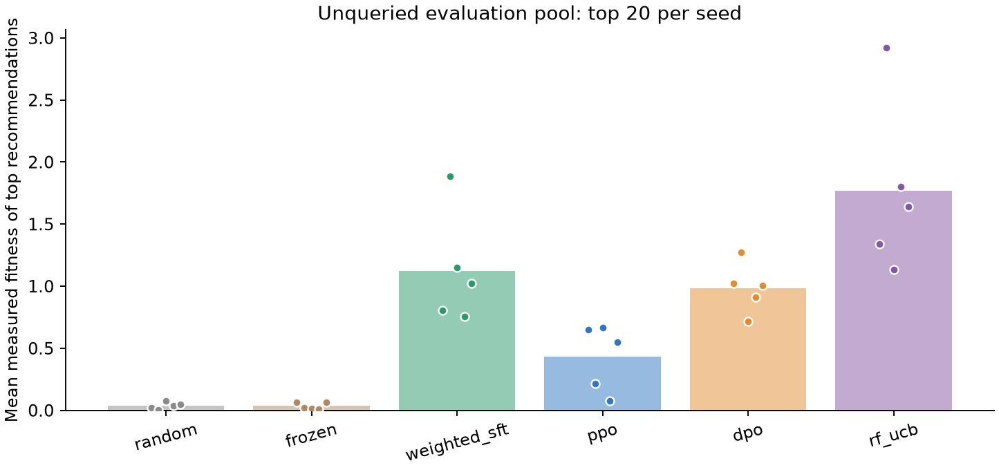

# Protein Feedback Lab

**Does post-training a protein sequence model help when experimental measurements
are limited?**

This project compares PPO and DPO with random sampling, a frozen transformer
prior, reward-weighted supervised learning and random-forest acquisition on a
historical GB1 binding landscape. A causal transformer is implemented in PyTorch
and initialized from random weights. The feedback comes from published measured
fitness, exposed through a no-repeat query budget.

The benchmark is intentionally small and auditable. It is retrospective replay,
not new wet-lab validation or frontier-model training. A four-site policy
conditions on the full 56-residue GB1 domain. GPU training optionally starts with
from-scratch language-model training on a sampled UniProt/Swiss-Prot corpus.

## What is implemented

- Causal transformer, sequence adaptation and checkpoint selection.
- PPO with correct without-replacement sampling likelihoods and a reference KL.
- DPO using preferences derived only from observed measurements.
- Equal-budget non-RL baselines and all-seed reporting.
- Label-independent pool assignment, frozen recommendations, and a metric verifier.
- A bounded, finite Modal GPU job; no always-on service or persistent GPU allocation.

## Measured results

The completed GPU study trained a **3,203,072-parameter transformer from random
weights on 11,750,198 amino-acid targets**, using 28,764 sampled training proteins
and 3,236 validation proteins. It then adapted the model to GB1 and compared six
acquisition/post-training methods over five seeds, with 128 common initial
measurements and 256 additional queries per method. Recommendations were frozen
on a disjoint 4,096-variant evaluation pool before its fitness values were read.

| Method | Acquired hits above wild type, mean | Held-out top-20 mean fitness |
|---|---:|---:|
| Random | 5.6 | 0.038 |
| Frozen transformer | 11.6 | 0.035 |
| Reward-weighted SFT | 26.2 | 1.125 |
| PPO | 13.0 | 0.433 |
| DPO | 31.8 | 0.986 |
| Random forest UCB | 49.0 | 1.769 |

In this configuration, DPO and PPO improved the held-out average over the frozen
prior. Reward-weighted SFT was a strong neural baseline, and random-forest UCB
had the highest averages. The useful result is a controlled comparison, including
the simpler methods that win. Five seeds on one four-site landscape do not
establish a general algorithm ranking.

[Full GPU report, every seed, and variability](results/gpu-study/RESULTS.md) ·
[Three-seed CPU pilot](results/cpu-pilot/RESULTS.md)



The cloud run is complete and its app is stopped. Training code is frozen at
`fdadc25`; later commits add reports and documentation. Exact source hashes and
environment versions are in `results/gpu-study/protocol_frozen.json`. Checkpoints
and the complete original GPU run archive are available in the
[v0.1.0 release](https://github.com/JoshuaDavid7/protein-feedback-lab/releases/tag/v0.1.0).

## Run locally

Python 3.11 or 3.12. Intel macOS uses PyTorch 2.2.2; the GPU runner pins PyTorch
2.7.1. Model checkpoints created by this project contain only local model state.

```bash
uv venv --python 3.12
# On Intel macOS:
uv pip install 'torch==2.2.2' 'numpy<2'
uv pip install '.[dev]'
source .venv/bin/activate
pytest -q
protein-feedback fetch
protein-feedback run --config configs/smoke.json --output artifacts/smoke
protein-feedback run --config configs/cpu.json --output artifacts/cpu-pilot
protein-feedback verify --output artifacts/cpu-pilot
```

The smoke configuration checks the complete path; it is not a research result.
Completed output directories cannot be overwritten.

## GPU study

```bash
uv pip install '.[cloud]'
modal token new --expires-in 12h
modal run cloud/modal_run.py --output cloud-output/gpu-study.zip
```

The registered GPU study uses five acquisition/adaptation seeds and a shared
from-scratch corpus-pretraining checkpoint. Its function has one A100-40GB,
two requested CPU cores, 16 GiB RAM, a four-hour timeout, one container and no
automatic retries. At the pricing checked on October 31, 2026, requested execution
resources would be approximately $9.30 for the full timeout, before image-build
overhead. The planning ceiling is $20 inside a user-approved $50 budget. These
are planning estimates, not a provider-enforced account spending limit. See
[Modal pricing](https://modal.com/pricing) and `cloud/modal_run.py`.

## Read the study

- [Protocol and honest scope](docs/PROTOCOL.md)
- [Data provenance and benchmark pitfalls](docs/DATA.md)
- [Questions to understand before discussing the project](docs/INTERVIEW_GUIDE.md)

Published run reports under `results/` include every method and seed, learning
curves, frozen recommendations, checksums and software versions. Large checkpoint
files are kept in release assets instead of Git history. The GPU SKU requested
was A100-40GB; the runtime reported an A100-SXM4-80GB device. The manifest records
the observed hardware. Numerical identity across different hardware or PyTorch
versions is not promised.

## Inspect a trained policy

After extracting the release archive:

```python
from pathlib import Path
from protein_feedback.data import encode
from protein_feedback.model import ProteinTransformer, score_variants

policy = ProteinTransformer.load(Path("models/11_dpo.pt"), device="cpu").eval()
scores = score_variants(policy, encode(["VDGV", "AAAA"]), device="cpu")
print(scores.tolist())
```

These are action-sequence log probabilities, not predicted binding constants.
The exact 56-aa context and four variable positions are defined in `data.py`.

## Method references

- Wu et al., [GB1 experimental landscape](https://doi.org/10.7554/eLife.16965), 2016.
- Dallago et al., [FLIP benchmark](https://github.com/J-SNACKKB/FLIP), 2021.
- Schulman et al., [Proximal Policy Optimization](https://arxiv.org/abs/1707.06347), 2017.
- Rafailov et al., [Direct Preference Optimization](https://arxiv.org/abs/2305.18290), 2023.

Original code is MIT-licensed; datasets keep their source licenses. Development
uses AI-assisted coding, with explicit tests, reproducible runs, and human review
needed to support authorship and interview claims.

