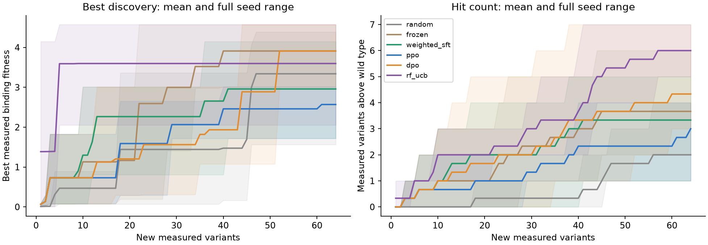
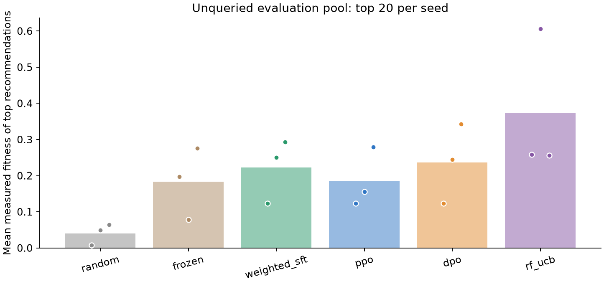

# Results

Configuration: `cpu_pilot`. 30,912 parameters; seeds [11, 23, 37].

Each method receives the same initial observations and the same number of new measurement queries. Evaluation recommendations are frozen before held-out fitness is read. Fitness is the historical assay's relative binding enrichment; a value above 1 exceeds the assay wild type.

| Method | Best queried fitness | Queried hits > WT | Held-out top-k mean fitness | Held-out top-k hits > WT | Run seconds |
|---|---:|---:|---:|---:|---:|
| random | 3.339 +/- 1.547 | 2.000 +/- 1.732 | 0.040 +/- 0.030 | 0.000 +/- 0.000 | 0.062 +/- 0.012 |
| frozen | 3.910 +/- 0.809 | 3.667 +/- 2.082 | 0.184 +/- 0.100 | 1.000 +/- 1.000 | 0.528 +/- 0.102 |
| weighted_sft | 2.958 +/- 1.216 | 3.333 +/- 2.082 | 0.222 +/- 0.088 | 1.000 +/- 1.000 | 1.771 +/- 0.138 |
| ppo | 2.569 +/- 0.738 | 3.000 +/- 1.732 | 0.186 +/- 0.082 | 1.000 +/- 1.000 | 4.634 +/- 0.717 |
| dpo | 3.910 +/- 0.809 | 4.333 +/- 2.309 | 0.237 +/- 0.110 | 1.333 +/- 1.155 | 5.313 +/- 0.819 |
| rf_ucb | 3.596 +/- 1.352 | 6.000 +/- 1.000 | 0.374 +/- 0.201 | 2.333 +/- 2.309 | 1.072 +/- 0.203 |

Values are mean +/- sample standard deviation across the declared seeds, not confidence intervals. The number of seeds is too small for strong superiority claims. Inspect every individual run in `results.json`.





## Scope

- Retrospective replay, not new wet-lab experiments.
- Four mutable sites in one GB1 domain.
- Single-machine training, not distributed frontier-model training.
- Public historical labels cannot provide independent blinding.
- No hyperparameter changes based on evaluation results.

The FLIP `keep` mask is outcome-dependent and is deliberately unused. The long fusion-construct sequence is also unused; the policy conditions on the 56-residue GB1 domain and chooses only the four assayed sites.

## Recompute these numbers

```bash
protein-feedback verify --output results/cpu-pilot --data data
```
