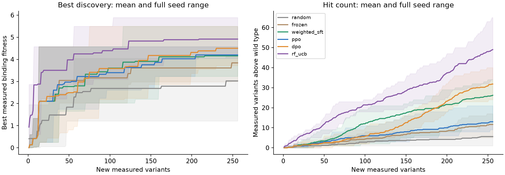
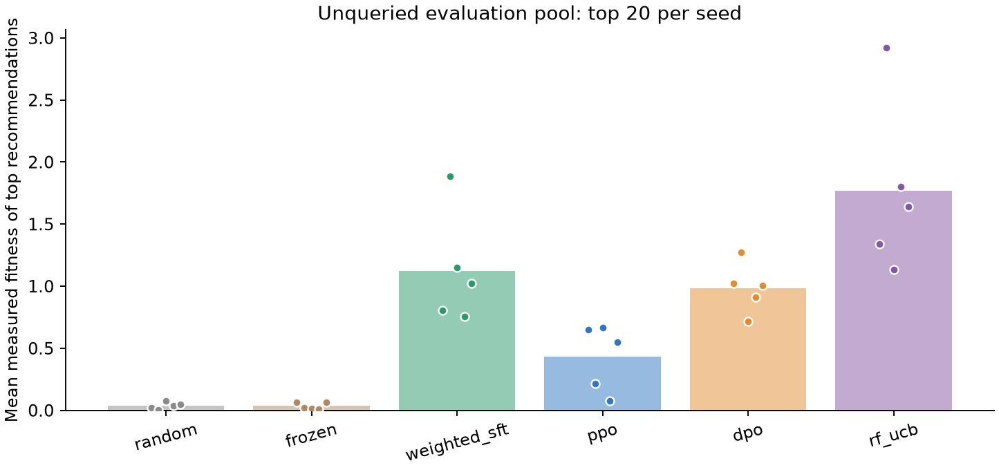
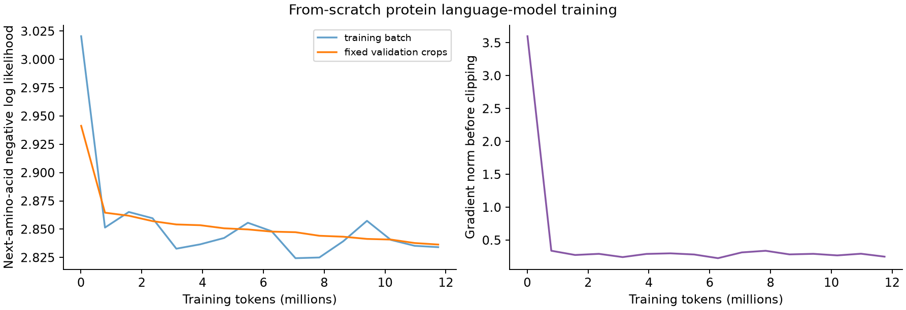

# Results

Configuration: `gpu_study`. 3,203,072 parameters; seeds [11, 23, 37, 53, 71].

Each method receives the same initial observations and the same number of new measurement queries. Evaluation recommendations are frozen before held-out fitness is read. Fitness is the historical assay's relative binding enrichment; a value above 1 exceeds the assay wild type.

| Method | Best queried fitness | Queried hits > WT | Held-out top-k mean fitness | Held-out top-k hits > WT | Run seconds |
|---|---:|---:|---:|---:|---:|
| random | 3.023 +/- 1.350 | 5.600 +/- 4.561 | 0.038 +/- 0.027 | 0.200 +/- 0.447 | 0.070 +/- 0.001 |
| frozen | 3.840 +/- 0.643 | 11.600 +/- 4.336 | 0.035 +/- 0.028 | 0.000 +/- 0.000 | 0.909 +/- 0.005 |
| weighted_sft | 4.158 +/- 0.889 | 26.200 +/- 9.176 | 1.125 +/- 0.454 | 8.600 +/- 2.793 | 1.682 +/- 0.034 |
| ppo | 4.199 +/- 0.214 | 13.000 +/- 5.339 | 0.433 +/- 0.268 | 3.200 +/- 1.643 | 11.822 +/- 0.154 |
| dpo | 4.500 +/- 0.660 | 31.800 +/- 6.573 | 0.986 +/- 0.203 | 7.800 +/- 1.483 | 2.461 +/- 0.019 |
| rf_ucb | 4.916 +/- 0.645 | 49.000 +/- 11.769 | 1.769 +/- 0.695 | 12.600 +/- 3.578 | 2.292 +/- 0.024 |

Values are mean +/- sample standard deviation across the declared seeds, not confidence intervals. The number of seeds is too small for strong superiority claims. Inspect every individual run in `results.json`.





## Scope

- Retrospective replay, not new wet-lab experiments.
- Four mutable sites in one GB1 domain.
- Single-machine training, not distributed frontier-model training.
- Public historical labels cannot provide independent blinding.
- No hyperparameter changes based on evaluation results.

The FLIP `keep` mask is outcome-dependent and is deliberately unused. The long fusion-construct sequence is also unused; the policy conditions on the 56-residue GB1 domain and chooses only the four assayed sites.

## Recompute these numbers

```bash
protein-feedback verify --output results/gpu-study --data data
```

## Corpus pretraining

11,750,198 amino-acid targets; 28,764 sampled training proteins and 3,236 validation proteins. All study seeds share this corpus checkpoint; the acquisition/adaptation runs are separately seeded.



This learning curve is not evidence of frontier-model capabilities or structure-aware generalization. There is no homology-disjoint test or language-model baseline comparison. The CPU and GPU configurations also differ in model size, so their comparison does not isolate the effect of corpus pretraining.
